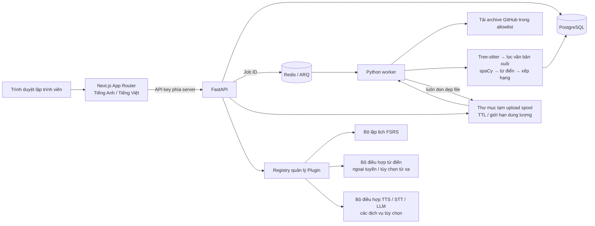
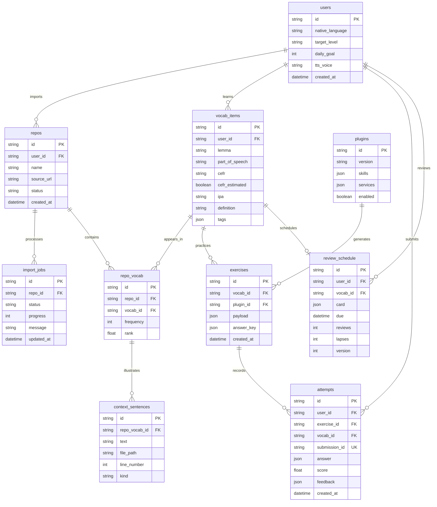

# Kiến trúc hệ thống CodeLingo (Architecture)

> Quyết định triển khai cập nhật: người dùng ưu tiên sử dụng các dịch vụ đám mây miễn phí để tránh chạy các tác vụ nặng trên máy tính cá nhân. Mô hình triển khai khuyến nghị hiện tại là [cấu hình cloud](cloud-deployment.vi.md). Kiến trúc tự host (Docker Compose) bên dưới là thiết kế ban đầu và vẫn đóng vai trò như một môi trường phát triển/triển khai tùy chọn. Cả hai mô hình đều sử dụng chung schema từ vựng, hợp đồng plugin, bộ trích xuất và thuật toán FSRS.

## 1. Đánh giá kiến trúc và các quyết định cốt lõi

Giữ nguyên Next.js App Router + TypeScript, FastAPI, PostgreSQL, Redis, và ARQ. Python đảm nhiệm đường ống trích xuất, các bộ điều hợp dịch vụ (adapters), chấm điểm bài tập và thuật toán FSRS; trình duyệt không bao giờ tự tính toán lịch ôn tập. ARQ gọn nhẹ và phù hợp hơn Celery cho dịch vụ async FastAPI. Redis chỉ chứa ID công việc (job ID), tuyệt đối không lưu trữ mã nguồn người dùng tải lên. Một worker đơn lẻ là đủ đáp ứng nhu cầu cho bản MVP.

Các quyết định sản phẩm đã chốt: triển khai self-hosted cho người dùng đơn; ưu tiên import qua file ZIP và kho lưu trữ GitHub công khai; tính năng OAuth cho repo riêng tư để lại sau; truy cập từ điển qua mạng mặc định ở trạng thái tắt. Môi trường phát triển cục bộ cũng hỗ trợ SQLite và bộ chạy job in-process (chạy trong cùng tiến trình). Đây là các giải pháp thay thế phục vụ dev, không phải hàng đợi tác vụ bền vững. Môi trường Docker Compose sử dụng PostgreSQL và ARQ tiêu chuẩn.

Không lưu trữ toàn bộ file mã nguồn để phục vụ Monaco Editor. Chỉ lưu trữ các đoạn trích ngữ cảnh ngắn đã được làm sạch và hiển thị trên editor ở chế độ chỉ đọc, kèm theo thông tin số dòng và đường dẫn file gốc. Các file nén tải lên được giữ tạm trong thư mục spool có giới hạn dung lượng cho đến khi worker đọc xong và sẽ bị xóa ngay trong khối `finally`, khi từ chối job, hoặc qua cơ chế dọn dẹp TTL định kỳ. Một sự cố sập nguồn có thể để lại file tạm cho đến khi chu kỳ dọn dẹp tiếp theo chạy. Tuyệt đối không lưu trữ mã nguồn hoàn chỉnh vào cơ sở dữ liệu.

Khử trùng lặp từ vựng theo bộ khóa `(user_id, lemma, part_of_speech)`, không khử trùng lặp toàn cục: việc chia sẻ ngữ cảnh toàn cục giữa các user sẽ làm rò rỉ từ vựng từ các dự án riêng tư. Tần suất xuất hiện theo từng repository thuộc về bảng `repo_vocab`; lịch ôn tập thuộc về từ vựng của người dùng, nhờ đó việc import một repo mới không làm thiết lập lại tiến độ học tập trước đó.

Rủi ro và đánh đổi kỹ thuật:

- Tree-sitter phân tích cú pháp cấu trúc mã, không đánh giá được liệu văn bản đó có phải là tiếng Anh hữu ích hay không. Ưu tiên văn bản xuôi (prose), giữ lại văn bản gốc, giới hạn kích thước đầu vào, loại bỏ các đoạn mã hoặc secret tiềm ẩn, và sử dụng bộ phát hiện ngôn ngữ cho các câu. Các từ định danh (identifiers) có thể bổ sung tần suất nhưng không tự bịa ra câu ngữ cảnh gốc.
- Cấp độ CEFR mang tính ước lượng, đặc biệt đối với các thuật ngữ kỹ thuật chuyên ngành. Một từ điển thuật ngữ kỹ thuật nhỏ được biên soạn thủ công cung cấp các cấp độ đã biết; các thuật ngữ tiếng Anh chưa rõ mặc định gán mức B2 ước lượng. Danh sách loại trừ A1 là danh sách lọc cơ bản, không phải bộ dữ liệu CEFR toàn diện. Cần đánh phiên bản cho chính sách trích xuất trước khi so sánh với các tập ngữ liệu thực tế.
- Bộ lọc secret là cơ chế phòng thủ theo chiều sâu (defense in depth), không phải lời đảm bảo tuyệt đối. Chặn các đoạn trích chứa dấu hiệu secret và các tên file nhạy cảm. Không có LLM nào nhìn thấy repository trong quá trình import. Tuyệt đối không thực thi mã nguồn repository, hooks, build script hay các đường dẫn trong file nén. Giới hạn nghiêm ngặt chống ZIP bombs, symlinks, path traversal, kích thước file và số lượng file.
- Phát âm không thể đo lường một cách đáng tin cậy chỉ qua độ tương đồng của văn bản chuyển đổi giọng nói. Độ khớp từ vựng của STT được dán nhãn rõ ràng là "độ khớp văn bản bóc tách" (transcript agreement). Việc so khớp âm vị (phoneme alignment) và chấm điểm chi tiết là một bộ điều hợp riêng biệt và thuộc lộ trình tương lai.
- Các model chạy cục bộ (TTS, STT, LLM) có yêu cầu phần cứng (RAM/CPU) và giấy phép độc lập. Trạng thái sẵn sàng của dịch vụ được hiển thị rõ; khi dịch vụ vắng mặt, hệ thống báo trạng thái "chưa có thông tin" có thể thao tác được, thay vì tự bịa điểm số.
- Khóa API key đơn người dùng là biện pháp bảo vệ lớp triển khai, không phải hệ thống xác thực phân quyền đa người dùng. Gắn API vào loopback cục bộ, chuyển tiếp yêu cầu của trình duyệt qua Next.js, và cấu hình TLS/xác thực tại reverse proxy khi cần truy cập từ xa. Không mở trực tiếp bản MVP này ra internet công cộng mà không có lớp bảo vệ.

## 2. Sơ đồ hệ thống (System diagram)

### Sơ đồ quan hệ thực thể (ERD)

Ràng buộc toàn vẹn dữ liệu: tính duy nhất trên các cặp `(user, lemma, POS)`, `(repo, vocab)`, lịch ôn tập `(user, vocab)` và `submission_id`. Thao tác xóa tầng (cascade) xóa ngữ cảnh của repo; xóa một repo vẫn giữ nguyên các từ đã học và lịch ôn tập trong khi loại bỏ các ngữ cảnh liên quan của repo đó. Xóa một từ vựng sẽ xóa toàn bộ dữ liệu học tập liên quan đến từ đó. Mọi mốc thời gian lưu trong DB đều dùng chuẩn UTC; múi giờ của người dùng quyết định việc tính toán mục tiêu ngày và chuỗi streak. Các phản hồi API luôn ẩn đáp án bài tập (`answer_key`).

## 3. Hợp đồng Plugin (Plugin contract)

Các file hợp đồng định kiểu chuẩn: `shared/plugins.ts` và `backend/app/contracts.py`. Các plugin khai báo phiên bản, kỹ năng và các phụ thuộc dịch vụ. Hàm sinh bài tập (generation) nhận từ vựng và hồ sơ người học, trả về danh sách bài tập kèm đáp án nội bộ (`answer_key`). Hàm chấm điểm (grading) trả về điểm số chuẩn hóa trong khoảng 0–1, các sửa lỗi gợi ý và giải thích. Mọi yêu cầu tài nguyên đa phương tiện (audio/text) đều thực hiện qua các bộ điều hợp (adapters), tuyệt đối không nhúng SDK của nhà cung cấp trực tiếp vào plugin. Các bài tập và đáp án đã sinh được lưu trên server; phía client chỉ gửi lên ID bài tập và câu trả lời. Đánh giá độ khó khi ôn tập flashcard là do người học tự thẩm định và được xử lý riêng bởi thuật toán FSRS.

Module luyện chép chính tả (dictation) hoàn chỉnh nằm trong `backend/app/plugins.py`: ngữ cảnh gốc → văn bản TTS → lời nhắc chính tả → khoảng cách chỉnh sửa cấp độ từ chuẩn hóa → điểm số và phản hồi. Người học không thể lấy đáp án qua API bài tập trước khi nộp bài. Đoạn văn bản bóc tách có thể lấy về như một phản hồi sau khi đã gửi bài nộp.

## 4. Chính sách trích xuất từ vựng (Extraction policy)

Lệnh `python -m app.extraction path/to/repo` xuất ra kết quả JSON đã được xếp hạng. Các ngôn ngữ hỗ trợ: TypeScript, TSX, JavaScript, Python, Java, và Go. File Markdown được xử lý bên ngoài các khối code block. Bóc tách vị trí byte offset bằng Tree-sitter, giữ nguyên số dòng nguồn gốc, tách từ dạng camelCase / acronyms / snake_case, chuẩn hóa văn bản xuôi bằng spaCy, loại bỏ stopwords / từ khóa cú pháp / từ vựng A1 cơ bản, và kết hợp hàm logarit tần suất × độ khó × tính hữu dụng công sở × chất lượng ngữ cảnh. Hàm logarit tần suất ngăn các định danh sinh tự động lặp đi lặp lại chiếm ưu thế. Model tiếng Anh của spaCy là bắt buộc; nếu thiếu model hệ thống sẽ báo lỗi kèm hướng dẫn cài đặt. Bộ nhận diện ngôn ngữ áp dụng cho văn bản xuôi, trong khi các từ định danh yêu cầu từ điển hoặc tín hiệu tần suất từ tiếng Anh. Mỗi từ trong mỗi repo chỉ giữ lại tối đa 3 ngữ cảnh gốc khác nhau. Các định nghĩa trong từ điển ban đầu là do dự án tự biên soạn; tính năng tra từ điển từ xa là tùy chọn và chỉ tra từ đơn lẻ. Tuyệt đối không tự bịa phiên âm hoặc định nghĩa cho các từ chưa rõ.

## 5. Kế hoạch triển khai MVP 4 tuần và bản v1

| Tuần | Mục tiêu bàn giao | Tiêu chí chấp nhận |
| :--- | :--- | :--- |
| 1 | Import, xử lý file nén an toàn, bóc tách TypeScript/Python, lọc spaCy, PostgreSQL/ARQ | Test trích xuất repo mẫu vượt qua; xử lý lỗi ZIP/GitHub rõ ràng; xóa sạch mã nguồn tạm |
| 2 | Trình duyệt từ vựng, ngữ cảnh gốc, flashcards, FSRS, bảng điều khiển | Chu trình Import → Ôn tập hoạt động bền vững qua các lần restart; test khử trùng lặp và ôn tập đồng thời |
| 3 | Luyện chép chính tả và đọc hiểu; adapter TTS cục bộ, hiển thị trạng thái dịch vụ | Âm thanh thật từ provider được cấu hình; chấm điểm xác định; import offline không đổi |
| 4 | Giao diện tiếng Việt, xuất dữ liệu, kiểm soát quyền riêng tư, hoàn thiện triển khai | Smoke test Compose; xóa repo an toàn; xuất CSV/Anki; tài liệu vận hành hoàn chỉnh |

Phiên bản v1: tài khoản đa người dùng và mã hóa thông tin xác thực GitHub OAuth; truy cập repo riêng tư với GitHub App token phân quyền tối thiểu; import gia tăng bám theo commit SHA; bóc tách ngữ cảnh từ git log / PR; bộ ngữ liệu CEFR / từ điển chuẩn hóa; ghi âm STT và so khớp âm vị; kỹ thuật shadowing, giải thích hàm code, mô phỏng standup meeting và phỏng vấn; nhận xét bài viết qua Ollama với JSON schema nghiêm ngặt; cơ chế cài đặt plugin từ người dùng kèm chính sách cách ly an toàn; sao lưu / phục hồi và giám sát hệ thống. Khung mã nguồn hiện tại đã bao gồm các adapter tùy chọn và các plugin đầu tiên, trong khi OAuth, chấm âm vị và mô phỏng tương tác công sở là các hạng mục trong lộ trình phát triển.

Tài liệu tham khảo sử dụng trong quá trình triển khai: [tree-sitter Python bindings](https://github.com/tree-sitter/py-tree-sitter), [spaCy English models](https://spacy.io/models/en), [py-fsrs](https://pypi.org/project/fsrs/). Xem các file lockfile đã ghim để biết chính xác phiên bản cài đặt.
