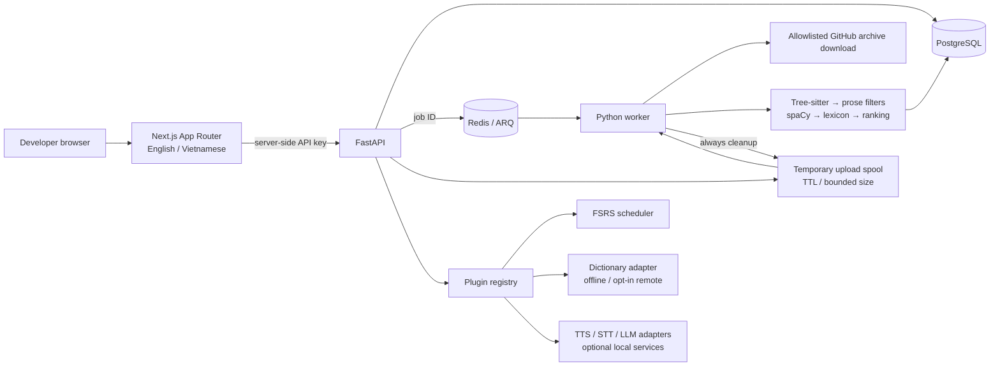
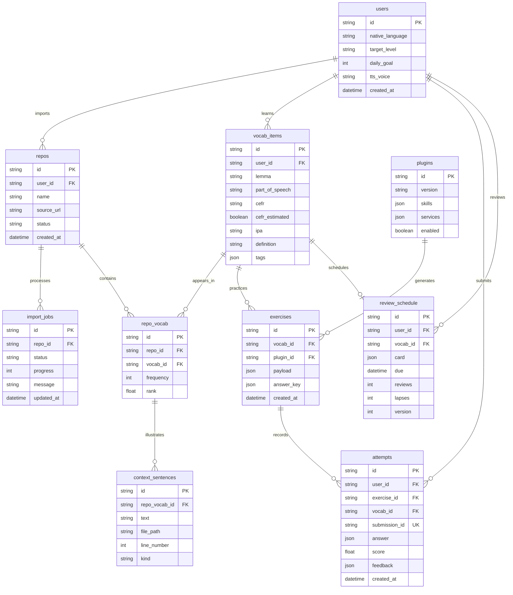

# CodeLingo architecture

> Updated deployment decision: the user prefers free managed services to avoid running heavy workloads on a personal computer. The recommended implementation is now [the cloud profile](cloud-deployment.vi.md). The self-hosted architecture below is the original design and remains an optional development/deployment profile. Both use the same vocabulary schema, plugin contracts, extractor, and FSRS logic.

## 1. Architecture review and decisions

Keep Next.js App Router + TypeScript, FastAPI, PostgreSQL, Redis, and ARQ. Python owns extraction, service adapters, grading and FSRS; the browser never computes review schedules. ARQ is a smaller fit than Celery for an async FastAPI service. Redis contains job IDs, never uploaded source. A single worker is sufficient for the MVP.

Confirmed product decisions: single-user self-hosted deployment; ZIP and public GitHub imports first; private OAuth later; dictionary network access off by default. Local development also supports SQLite and an in-process job runner. These are explicit development alternatives, not a durable job queue. Docker Compose uses PostgreSQL and ARQ.

Do not retain whole files to support Monaco. Display only retained, sanitized context excerpts in a read-only editor, with original file/line references. Upload archives exist in a bounded temporary spool until a worker reads them and are deleted in a finally block, on job rejection, or by a TTL cleanup. A crash can leave temporary files until cleanup runs. Completed source is never stored in the database.

Deduplicate by `(user_id, lemma, part_of_speech)`, not globally: global context sharing would leak private project vocabulary. Repository-specific frequencies belong to `repo_vocab`; review schedules belong to user vocabulary, so importing another repo does not reset learning.

Risks and tradeoffs:

- Tree-sitter parses structure, not whether text is useful English. Prefer prose, retain original text, cap input, reject probable code and secrets, and use language detection for sentences. Identifier words can supplement frequency without fabricating original sentences.
- CEFR is an estimate, especially for technical terms. A small reviewed technical lexicon supplies known levels; unknown English terms have an explicitly estimated B2 default. A1 exclusion is an editorial seed list, not an exhaustive CEFR dataset. Version the extraction policy before production corpus comparisons.
- Secret filtering is defense in depth, not a guarantee. Block secret-bearing snippets and sensitive file names. No LLM sees a repository during import. Never execute repository code, hooks, build scripts, or archive paths. ZIP bombs, symlinks, traversal, input size, and file count are bounded.
- Pronunciation cannot be measured reliably by transcript similarity. STT word agreement is labeled as transcript agreement. Phoneme alignment/scoring is a separate adapter and future integration.
- Local TTS, STT, and LLM models have independent RAM/CPU requirements and licenses. Service readiness is visible; absent services produce an actionable unavailable state rather than invented grades.
- A single-user API key is deployment protection, not multi-user authentication. Bind the API to loopback, proxy browser requests through Next, and add TLS/authentication at the reverse proxy for remote access. Do not expose this MVP directly to the public internet.

## 2. System diagram

### ERD

Constraints: unique user/lemma/POS, repo/vocab, user/vocab schedule, and submission ID. Cascades delete repo context; deleting a repo preserves learned words and schedules while removing its context. Word deletion removes its learning data. UTC timestamps are persisted; the user's timezone defines daily goals and streaks. API responses omit exercise answer keys.

## 3. Plugin contract

Canonical equivalents: `shared/plugins.ts` and `backend/app/contracts.py`. Plugins declare version, skills, and service dependencies. Generation accepts vocabulary and a user profile, and yields exercises with an internal answer key. Grading returns a normalized 0–1 score, corrections, and an explanation. Media is requested through adapters, never a provider SDK inside a plugin. Persist generated exercises and keys on the server; clients submit only exercise ID and answer. Review ratings are learner self-assessment and are handled separately by FSRS.

The worked dictation implementation lives in `backend/app/plugins.py`: original context → TTS text → dictation prompt → normalized word-level edit distance → score and feedback. Learners cannot fetch the answer through the exercise API before submitting. Transcripts can be retrieved as feedback after submission.

## 4. Extraction policy

`python -m app.extraction path/to/repo` emits ranked JSON. Supported grammars: TypeScript, TSX, JavaScript, Python, Java, and Go. Markdown is processed outside code fences. Parse byte offsets with tree-sitter, preserve source line numbers, split camelCase/acronyms/snake_case, normalize prose with spaCy, exclude stopwords/keywords/A1 seeds, and combine logarithmic frequency × difficulty × workplace usefulness × context quality. Logarithmic frequency prevents repetitive generated identifiers from dominating. The spaCy English model is mandatory; missing models fail with installation guidance. Language detection applies to prose, while identifiers require a lexicon or English word-frequency signal. At most three distinct original contexts are retained per term per repo. Definitions in the bundled seed lexicon are project-authored; remote dictionary lookup is optional and word-only. No pronunciation/definition is fabricated for unknown words.

## 5. Four-week MVP and v1

| Week | Deliverable | Acceptance |
| --- | --- | --- |
| 1 | Import, bounded archives, TypeScript/Python parsing, spaCy filtering, PostgreSQL/ARQ | Sample-repo extraction tests; ZIP/GitHub failures reported; temporary source removed |
| 2 | Vocabulary browser, original context, flashcards, FSRS, dashboard | Import → review survives restart; deduplication and concurrent/stale review tests |
| 3 | Dictation and reading; local TTS adapter, service status | Real audio from configured provider; deterministic grading; offline import unchanged |
| 4 | Vietnamese UI, exports, privacy controls, deployment hardening | Compose smoke test; repo removal; CSV/Anki export; operator documentation |

v1: multi-user accounts and encrypted GitHub OAuth credentials; private repository access with least-privilege GitHub App tokens; incremental imports pinned to commit SHA; git/PR prose; calibrated CEFR/dictionary corpus; STT recording and phoneme alignment; shadowing, function explanation, standup and interview practice; Ollama writing feedback with strict output schemas; user-installed plugins with an isolation policy; backup/restore and observability. The scaffold includes optional adapters and the first plugin implementations, while OAuth, phoneme scoring, and interactive workplace simulations remain roadmap work.

References used for implementation: [tree-sitter Python bindings](https://github.com/tree-sitter/py-tree-sitter), [spaCy English models](https://spacy.io/models/en), [py-fsrs](https://pypi.org/project/fsrs/). See the pinned lockfiles for installed versions.
