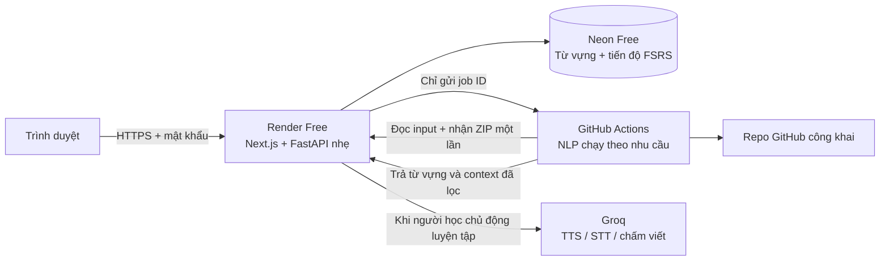

# Chạy CodeLingo trên cloud, ưu tiên miễn phí

Máy cá nhân chỉ cần trình duyệt. Không cần Docker, PostgreSQL, Redis, spaCy, Piper, Whisper hay Ollama trên máy của bạn.

## Cấu hình được chọn

| Công việc | Dịch vụ | Ghi chú |
| --- | --- | --- |
| Web Next.js + API FastAPI nhẹ | Render Free, một web service | Không cài NLP/model trong web image |
| PostgreSQL lưu từ vựng và tiến độ | Neon Free | Dữ liệu tồn tại khi web ngủ hoặc khởi động lại |
| Phân tích repo bằng tree-sitter + spaCy | GitHub Actions | Chạy theo lượt import rồi tắt; không cần worker/Redis thường trực |
| Nghe, nhận diện giọng nói, chấm viết | Groq API, tùy chọn | Không tải model về máy; có hạn mức miễn phí |
| Ôn tập FSRS, đọc, xuất CSV/Anki | API trên Render | Không tiêu thụ lượt AI |

Đây là lựa chọn thực dụng cho một người dùng. Giữ nguyên giao diện và logic học; thay phần vận hành nặng bằng dịch vụ quản lý. Không dùng Vercel cho cả luồng ZIP để tránh giới hạn payload 4.5 MB của function, và không dùng database Render Free cho dữ liệu học lâu dài vì gói đó hết hạn sau 30 ngày.

## Miễn phí tới mức nào?

Kiểm tra theo tài liệu dịch vụ ngày 27/10/2026; giới hạn có thể thay đổi:

- [Render Free](https://render.com/docs/free): 750 giờ instance/workspace/tháng. Service ngủ sau 15 phút không có traffic; mở lại có thể mất khoảng một phút. File tạm mất khi ngủ/restart. Render mô tả Free phù hợp hobby/demo, không đảm bảo vận hành production.
- [Neon Free](https://neon.com/pricing): $0, hiện có 1 GB PostgreSQL và 100 CU-giờ/tháng/project; tự scale về 0 khi không dùng. Không cần thẻ theo trang giá hiện tại.
- [GitHub Actions](https://docs.github.com/en/billing/concepts/product-billing/github-actions): GitHub Free có 2.000 phút/tháng cho repo riêng tư; standard runners của repo công khai được miễn phí. Chọn repo riêng tư cho ứng dụng nếu không muốn công khai mã ứng dụng. Không upload source repo người học thành artifact hay in nó vào log.
- [Groq](https://console.groq.com/docs/rate-limits): có hạn mức free theo model, số request/token và thời lượng âm thanh. Hết hạn mức thì báo chờ, không tự chuyển qua API có phí.

Mục tiêu là $0 trong hạn mức cho sử dụng cá nhân; không hứa miễn phí vô hạn. Có thể không cấu hình Groq mà vẫn import, học từ, luyện đọc và ôn FSRS bình thường. Kiểm tra budget/usage của các tài khoản và không bật gói trả phí nếu không cần.

## Triển khai hoàn toàn qua trình duyệt

1. Đưa mã ứng dụng này vào một repository GitHub của bạn, nhánh `main`. Đây là repo **ứng dụng CodeLingo**, khác với các repo bạn nhập để học. Bật GitHub Actions cho repo; workflow `.github/workflows/extract.yml` phải nằm trên default branch.
2. Tạo database Neon Free, copy connection string **pooled** có SSL. Đổi phần đầu từ `postgresql://` thành `postgresql+psycopg://`, giữ `?sslmode=require` và các tham số SSL khác nếu có. Không đưa URL có mật khẩu vào Git.
3. Tạo fine-grained GitHub token, chỉ cho phép repo ứng dụng, quyền **Actions: write**. Không cấp quyền đọc mọi repo riêng tư. Token này chỉ dispatch workflow; workflow có `contents: read` và không lưu checkout credentials.
4. Trên Render chọn **New → Blueprint**, kết nối repo ứng dụng. Blueprint `render.yaml` chọn một web service Free với `Dockerfile.cloud`; các bước build chạy trên Render, không chạy trên máy bạn.
5. Điền secret/config trên Render (Groq là biến tùy chọn, có thể thêm sau trong Environment):

| Biến | Giá trị |
| --- | --- |
| `DATABASE_URL` | Connection string Neon bước 2 |
| `API_KEY` | Blueprint tự tạo; đây là khóa máy-máy, không đưa vào trình duyệt |
| `WORKSPACE_PASSWORD` | Mật khẩu riêng ít nhất 16 ký tự, khác API key |
| `GITHUB_ACTIONS_TOKEN` | Token giới hạn ở bước 3 |
| `GITHUB_ACTIONS_REPO` | `username/repo-ung-dung-codelingo` |
| `GROQ_API_KEY` | Tùy chọn; để trống nếu chưa cần giọng nói/AI |

6. Sau khi Render deploy và có URL `https://TEN-APP.onrender.com`, thêm **GitHub repository secrets** trong repo ứng dụng:

| Secret | Giá trị |
| --- | --- |
| `CODELINGO_URL` | URL Render, không thêm `/api` |
| `CODELINGO_API_KEY` | Cùng giá trị `API_KEY` trên Render |

7. Mở URL Render, đăng nhập hộp thoại trình duyệt: username **`codelingo`**, password là `WORKSPACE_PASSWORD`. Chọn Import repository → kho mã mẫu, rồi xem Vocabulary và Spaced review. Quá trình cài dependency NLP lần đầu chạy trên GitHub, có thể mất vài phút.

Các adapter Groq dùng HTTP trực tiếp; không yêu cầu cài SDK hay model. Có thể chỉnh `GROQ_TTS_MODEL`, `GROQ_VOICE`, `GROQ_STT_MODEL`, `GROQ_LLM_MODEL` nếu model/quyền truy cập tài khoản thay đổi. Mặc định tương ứng Orpheus English, giọng `troy`, Whisper Large V3 Turbo, GPT-OSS 20B. Một số model có thể cần chấp nhận điều khoản của nhà cung cấp trong tài khoản Groq trước khi dùng.

## Riêng tư và giới hạn cần biết

- Đây là workspace cá nhân có mật khẩu qua HTTPS; không phải hệ thống nhiều tài khoản. Mọi API dữ liệu đều đi qua lớp bảo vệ; chỉ health check được đọc công khai. Worker chỉ truy cập nhóm endpoint job bằng API key.
- Repo GitHub được tải thẳng trên runner. ZIP được giữ tạm trên Render cho đến khi runner nhận, rồi xóa; bản trên runner nằm trong thư mục tạm và xóa khi hoàn tất. Tắt/rớt host trong lúc chờ ZIP có thể làm import thất bại; cần tải ZIP lại. Tiến độ học đã lưu trong Neon vẫn giữ nguyên.
- Job bị kẹt được đánh dấu hết hạn khi cleanup chạy. Không chạy cron ping để né cơ chế ngủ của nhà cung cấp. Khi web đang hoạt động, có cleanup định kỳ và khi khởi động.
- Mỗi lần chỉ nhận một cloud import để tránh xếp quá nhiều job trong hạn mức miễn phí. Nếu GitHub Actions bị tắt/hết quota, cần xử lý trên tài khoản GitHub rồi nhập lại.
- Hệ thống giữ từ vựng và tối đa ba context ngắn mỗi từ/repo. Bộ lọc secret không đảm bảo bắt mọi dữ liệu nhạy cảm: chỉ nhập mã bạn có quyền xử lý qua tài khoản cloud này.
- Groq chỉ nhận câu của bài nghe, âm thanh ghi âm, hoặc context và câu trả lời của bài viết khi bạn sử dụng tính năng tương ứng. Không gửi toàn bộ repo cho LLM. Adapter không ghi âm thanh vào database; chính sách lưu dữ liệu phía Groq thuộc tài khoản nhà cung cấp.
- `DICTIONARY_ONLINE=false` mặc định; tùy chọn bật chỉ gửi từ đơn đến Free Dictionary API.

Chưa deploy vào tài khoản nào khi chưa có kết nối tài khoản/secret. `Dockerfile.cloud`, `render.yaml`, workflow và adapter là cấu hình triển khai đã chuẩn bị sẵn; không cần chạy bản Compose trên máy cá nhân.
