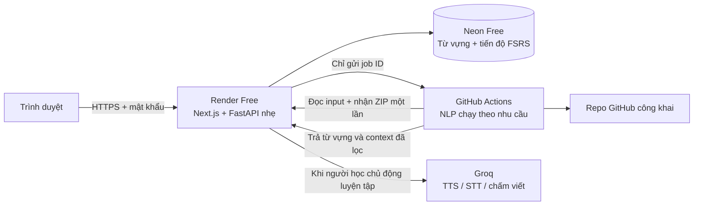

# Chạy CodeLingo trên cloud, ưu tiên miễn phí

Máy cá nhân chỉ cần trình duyệt. Không cần Docker, PostgreSQL, Redis, spaCy, Piper, Whisper hay Ollama trên máy của bạn.

## Cấu hình được chọn

| Công việc | Dịch vụ | Ghi chú |
| --- | --- | --- |
| Web Next.js + API FastAPI nhẹ | Render Free, một web service | Không cài NLP/model trong web image |
| PostgreSQL lưu từ vựng và tiến độ | Neon Free | Dữ liệu tồn tại khi web ngủ hoặc khởi động lại |
| Phân tích repo bằng tree-sitter + spaCy | GitHub Actions | Chạy theo lượt import rồi tắt; không cần worker/Redis thường trực |
| Nghe, nhận diện giọng nói, chấm viết | Groq API, tùy chọn | Không tải model về máy; có hạn mức miễn phí |
| Ôn tập FSRS, đọc, xuất CSV/Anki | API trên Render | Không tiêu thụ lượt AI |

Đây là lựa chọn thực dụng cho một người dùng. Giữ nguyên giao diện và logic học; thay phần vận hành nặng bằng dịch vụ quản lý. Không dùng Vercel cho cả luồng ZIP để tránh giới hạn payload 4.5 MB của function, và không dùng database Render Free cho dữ liệu học lâu dài vì gói đó hết hạn sau 30 ngày.

## Miễn phí tới mức nào?
Tra cứu lại theo tài liệu chính thức ngày **2026-11-06**; các giới hạn có thể thay đổi bất cứ lúc nào.

- [Render Free](https://render.com/docs/free): 750 giờ instance/workspace/tháng, không cộng dồn; service ngủ sau **15 phút** không có request, mở lại mất **khoảng 1 phút**; file cục bộ mất khi redeploy/restart/ngủ; không có persistent disk; Render có thể restart service Free bất cứ lúc nào. Hết giờ instance, hoặc vượt băng thông khi chưa gắn phương thức thanh toán, thì mọi service Free bị tạm dừng tới tháng sau. Render ghi rõ: không dùng gói Free cho production.
- [Neon Free](https://neon.com/pricing): 1 GB mỗi project, 100 CU-giờ mỗi project/tháng; compute tự tắt sau 5 phút không có truy vấn và bật lại ở truy vấn kế tiếp; cửa sổ lịch sử (khôi phục theo thời điểm) **6 giờ**; 10 branch mỗi project; không cần thẻ. Neon [khuyến nghị](https://neon.com/docs/connect/connection-pooling) dùng **kết nối trực tiếp** cho schema migration và `pg_dump`, kết nối pooled (PgBouncer transaction mode) cho app.
- [GitHub Actions](https://docs.github.com/en/billing/concepts/product-billing/github-actions): standard runner **miễn phí với repo công khai** và không trừ vào hạn mức. Repo `mrrayyyy/codelingo` đang công khai. Artifact của repo công khai ai cũng tải được, nên tuyệt đối không upload source người học hay bản dump database thành artifact.
- [Groq](https://console.groq.com/docs/rate-limits): bảng giới hạn gốc trong tài liệu ghi cho gói Developer; gói Free xem tại trang Limits của tài khoản. Theo bảng đó: `openai/gpt-oss-20b` 30 request/phút, 1.000 request/ngày, 200K token/ngày; `whisper-large-v3-turbo` 20 request/phút, 2.000 request/ngày, 28.800 giây âm thanh/ngày; `canopylabs/orpheus-v1-english` (TTS) chỉ **10 request/phút, 100 request/ngày, 3.600 token/ngày** và đang là model **Preview**, có thể bị ngừng với thông báo ngắn. Vượt hạn mức → HTTP 429 kèm header `retry-after`; ứng dụng báo chờ, không tự chuyển sang API trả phí.

Mục tiêu là $0 trong hạn mức cho một người dùng; không hứa miễn phí vô hạn. Có thể không cấu hình Groq mà vẫn import, học từ, luyện đọc và ôn FSRS bình thường. Vì hạn mức TTS rất thấp, các tính năng nghe/nói sẽ dùng giọng đọc có sẵn của trình duyệt/hệ điều hành làm dự phòng (xem lộ trình Giai đoạn 1 và 3).

## Triển khai hoàn toàn qua trình duyệt
Checklist cho chủ dự án. Mọi bước đều làm trên trình duyệt; không bước nào cần chạy Docker hay model trên máy cá nhân. Giữ các giá trị bí mật trong trình quản lý mật khẩu, **không** dán vào chat, ticket hay commit.

**Bước 0 — Repo ứng dụng.** Dùng chính repo `mrrayyyy/codelingo` (nhánh `main`, đã có `.github/workflows/extract.yml`). Kiểm tra tab **Actions** của repo đang bật.

**Bước 1 — Neon.**
1. Đăng nhập [console.neon.tech](https://console.neon.tech) → **New project**, region gần Singapore (ví dụ AWS ap-southeast-1), Postgres 17.
2. Mở **Connect**: copy **hai** connection string:
   - bật **Connection pooling** → chuỗi có `-pooler` trong host → dùng cho `DATABASE_URL`;
   - tắt **Connection pooling** → chuỗi kết nối trực tiếp → dùng cho `MIGRATION_DATABASE_URL`.
3. Với cả hai chuỗi: đổi phần đầu `postgresql://` thành `postgresql+psycopg://`, giữ nguyên `?sslmode=require` và các tham số khác.

**Bước 2 — GitHub token để kích hoạt workflow.**
1. GitHub → Settings → Developer settings → **Fine-grained tokens** → Generate new token.
2. Repository access: **Only select repositories** → `mrrayyyy/codelingo`. Permissions → Repository → **Actions: Read and write**. Không cấp quyền nào khác. Đặt hạn dùng (ví dụ 90 ngày) và ghi lịch nhắc thay token.

**Bước 3 — Groq (tùy chọn, có thể làm sau).** [console.groq.com](https://console.groq.com) → **API Keys** → Create. Xem trang **Limits** của tài khoản để biết hạn mức thật. Nếu console yêu cầu chấp nhận điều khoản cho model Orpheus TTS thì chấp nhận tại trang Playground/Models.

**Bước 4 — Render.**
1. [dashboard.render.com](https://dashboard.render.com) → **New → Blueprint** → kết nối GitHub, chọn repo `mrrayyyy/codelingo`. Render đọc `render.yaml`: một web service Free tên `codelingo`, region Singapore, build bằng `Dockerfile.cloud` trên máy của Render.
2. Điền các biến Render hỏi (secret không đồng bộ từ file):

| Biến | Giá trị |
| --- | --- |
| `DATABASE_URL` | Chuỗi Neon **pooled** (bước 1) |
| `MIGRATION_DATABASE_URL` | Chuỗi Neon **trực tiếp** (bước 1); khuyến nghị, để trống thì migration chạy qua chuỗi pooled |
| `API_KEY` | Blueprint tự sinh; khóa máy-máy, không dùng trong trình duyệt |
| `WORKSPACE_PASSWORD` | Mật khẩu riêng ≥ 16 ký tự, khác `API_KEY` — dùng để mở app |
| `GITHUB_ACTIONS_TOKEN` | Token bước 2 |
| `GITHUB_ACTIONS_REPO` | `mrrayyyy/codelingo` |
| `GROQ_API_KEY` | Key bước 3, hoặc để trống |

3. Bấm **Apply**. Lần build đầu mất vài phút. Khi deploy xong, lần khởi động đầu tiên tự tạo schema trên Neon (`alembic upgrade head`). Đây là thao tác `[gate]` của ticket triển khai: agent sẽ dừng để chủ dự án xác nhận trước bước này.

**Bước 5 — Secret cho GitHub Actions.** Khi có URL `https://<ten-service>.onrender.com`: repo `mrrayyyy/codelingo` → Settings → Secrets and variables → **Actions** → New repository secret:

| Secret | Giá trị |
| --- | --- |
| `CODELINGO_URL` | URL Render, không thêm `/api` |
| `CODELINGO_API_KEY` | Cùng giá trị `API_KEY` trên Render (Render → service → Environment → hiện giá trị) |

**Bước 6 — Mở app.** Vào URL Render trên máy tính và điện thoại; hộp thoại đăng nhập của trình duyệt: username **`codelingo`**, password là `WORKSPACE_PASSWORD`. Import repo mẫu Atlas, xem Từ vựng và Ôn tập. Lần import đầu cài dependency NLP trên runner GitHub nên có thể mất vài phút.

Các adapter Groq gọi HTTP trực tiếp, không cần SDK hay model. Có thể chỉnh `GROQ_TTS_MODEL`, `GROQ_VOICE`, `GROQ_STT_MODEL`, `GROQ_LLM_MODEL` trong Environment của Render nếu model hoặc quyền truy cập thay đổi. Ngày 2026-11-06 cả ba model mặc định (`canopylabs/orpheus-v1-english`, `whisper-large-v3-turbo`, `openai/gpt-oss-20b`) đều có trong danh sách model của Groq; giọng mặc định `troy` xuất hiện trong ví dụ của tài liệu TTS, sẽ được kiểm tra thật khi có API key.

## Sao lưu dữ liệu học tập

- Neon Free cho khôi phục theo thời điểm trong **6 giờ** gần nhất; đủ để quay lại ngay sau một migration hỏng, không đủ làm bản sao lưu dài hạn.
- Trước mỗi migration sau khi đã deploy, và định kỳ khi muốn: chạy `pg_dump` với chuỗi kết nối **trực tiếp**, lưu file ngoài repo (xem [quy trình tạo migration](quy_trinh/tao_migration.md)). Không lưu bản dump trong GitHub Actions artifact hay trong repo.

## Riêng tư và giới hạn cần biết

- Đây là workspace cá nhân có mật khẩu qua HTTPS; không phải hệ thống nhiều tài khoản. Mọi API dữ liệu đều đi qua lớp bảo vệ; chỉ health check được đọc công khai. Worker chỉ truy cập nhóm endpoint job bằng API key.
- Repo GitHub được tải thẳng trên runner. ZIP được giữ tạm trên Render cho đến khi runner nhận, rồi xóa; bản trên runner nằm trong thư mục tạm và xóa khi hoàn tất. Tắt/rớt host trong lúc chờ ZIP có thể làm import thất bại; cần tải ZIP lại. Tiến độ học đã lưu trong Neon vẫn giữ nguyên.
- Job bị kẹt được đánh dấu hết hạn khi cleanup chạy. Không chạy cron ping để né cơ chế ngủ của nhà cung cấp. Khi web đang hoạt động, có cleanup định kỳ và khi khởi động.
- Mỗi lần chỉ nhận một cloud import để tránh xếp quá nhiều job trong hạn mức miễn phí. Nếu GitHub Actions bị tắt/hết quota, cần xử lý trên tài khoản GitHub rồi nhập lại.
- Hệ thống giữ từ vựng và tối đa ba context ngắn mỗi từ/repo. Bộ lọc secret không đảm bảo bắt mọi dữ liệu nhạy cảm: chỉ nhập mã bạn có quyền xử lý qua tài khoản cloud này.
- Groq chỉ nhận câu của bài nghe, âm thanh ghi âm, hoặc context và câu trả lời của bài viết khi bạn sử dụng tính năng tương ứng. Không gửi toàn bộ repo cho LLM. Adapter không ghi âm thanh vào database; chính sách lưu dữ liệu phía Groq thuộc tài khoản nhà cung cấp.
- `DICTIONARY_ONLINE=false` mặc định; tùy chọn bật chỉ gửi từ đơn đến Free Dictionary API.

Chưa deploy vào tài khoản nào khi chưa có kết nối tài khoản/secret. `Dockerfile.cloud`, `render.yaml`, workflow và adapter là cấu hình triển khai đã chuẩn bị sẵn; không cần chạy bản Compose trên máy cá nhân.
